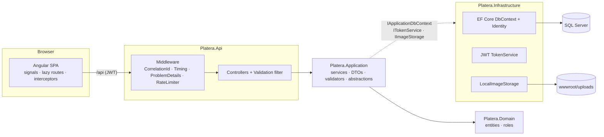

# Platera

> **Every dish has a story.** A community recipe book where home cooks share, rate and discover dishes from around the world.

Angular + ASP.NET Core + EF Core + SQL Server, built with Clean Architecture.

<!-- Screenshots: replace the placeholders below with real images in docs/screenshots/ -->
| Home | Recipe | Admin |
|------|--------|-------|
| _screenshot placeholder_ | _screenshot placeholder_ | _screenshot placeholder_ |

## Features
- **Users:** register / log in (JWT access + rotating refresh tokens), full CRUD on **their own** recipes (ingredients, ordered steps, 1–5 images, tags), likes, 1–5 star ratings (one per user, average shown), "I tried this" comments with an optional photo, profile with *my recipes* and *liked recipes*.
- **Discovery:** paginated feed, keyword search (title / ingredients / tags), filters (cuisine, category, max cook time, min rating) and sorting (newest, top rated, most liked, trending), featured and trending sections.
- **Admin:** dashboard (counts + latest activity), manage users (activate/deactivate, change role), manage/feature/edit/delete any recipe, moderate comments (hide / delete), manage categories and cuisines.
- **Look and feel:** warm "food magazine" theme, serif headings, dark mode, original SVG logo and illustrations, responsive and accessible (skip link, labelled controls, AA contrast, reduced-motion support).

## Tech stack
| Layer | Technology |
|-------|------------|
| API | ASP.NET Core Web API (.NET 10), Swagger/OpenAPI with JWT |
| Architecture | Clean Architecture: `Domain` → `Application` → `Infrastructure` → `Api` |
| Data | EF Core 10 code-first migrations, SQL Server (LocalDB by default) |
| Auth | ASP.NET Core Identity + JWT (access 15 min, refresh 14 days, rotated + hashed), roles `Admin` / `User` |
| Validation | FluentValidation (global action filter), manual DTO mapping |
| Logging | Serilog: console + rolling file (`logs/`), request logging, `CorrelationId` + `UserId` enrichers |
| Middleware (hand-written) | Global exception handling → RFC 7807 ProblemDetails · Correlation ID · request timing · rate limiting (auth + feedback) |
| Images | Upload API (magic-byte validation, ≤ 5 MB) behind `IImageStorage` (local disk now, blob storage later) |
| Web | Angular 22: standalone components, signals, lazy routes, guards (auth + admin), JWT/refresh + error interceptors, custom SCSS design system |
| Tests | xUnit: application-layer unit tests + `WebApplicationFactory` integration tests (EF InMemory) |

### Detected toolchain (when built)
- .NET SDK 10.0.400 (pinned in `global.json`)
- Node v24.20.0 · npm 11.6.1 · Angular CLI 22.2.7
- SQL Server: `(localdb)\MSSQLLocalDB`

## Architecture


## Running it locally

### Prerequisites
.NET 10 SDK, Node 20+ (24 tested), and SQL Server LocalDB (installed with Visual Studio) or any SQL Server instance.

### 1. Database
The API applies migrations and seeds data on startup (`Database:MigrateOnStartup`). To do it manually:
```bash
dotnet tool install --global dotnet-ef        # once
dotnet ef database update -p src/Platera.Infrastructure -s src/Platera.Api
```
Using another SQL Server? Override the connection string without editing files:
```bash
dotnet user-secrets init --project src/Platera.Api
dotnet user-secrets set "ConnectionStrings:Default" "Server=localhost;Database=Platera;Trusted_Connection=True;TrustServerCertificate=True" --project src/Platera.Api
```
Add a new migration after changing the model:
```bash
dotnet ef migrations add <Name> -p src/Platera.Infrastructure -s src/Platera.Api -o Persistence/Migrations
```

### 2. API (http://localhost:5283, Swagger at `/swagger`)
```bash
dotnet run --project src/Platera.Api --launch-profile http
```

### 3. UI (http://localhost:4200)
```bash
cd web
npm install
npm start          # ng serve; proxies /api, /seed and /uploads to the API on :5283
```

### Seeded accounts (development only)
| Role | Email | Password |
|------|-------|----------|
| Admin | `admin@platera.local` | `Admin@12345!` |

The dev password and a dev-only JWT signing key live in `src/Platera.Api/appsettings.Development.json` and are **only** read in the Development environment. In any other environment you must provide `Jwt:Key` (≥ 32 chars) and `Seed:AdminPassword` through user-secrets or environment variables; the admin user is not created without a password. 12 sample recipes (original SVG illustrations, see `tools/gen-seed-images.mjs`) are created by "Chef Maria" on first run.

### Tests and builds
```bash
dotnet build
dotnet test                 # 44 tests
cd web && npx ng build
```

## API overview
| Area | Endpoints |
|------|-----------|
| Auth | `POST /api/auth/register · login · refresh · logout`, `GET /api/auth/me` |
| Recipes | `GET /api/recipes` (q, cuisineId, categoryId, maxCookMinutes, minRating, tag, sort, page, pageSize) · `/featured` · `/trending` · `/mine` · `/liked` · `GET/POST/PUT/DELETE /api/recipes/{id}` |
| Interactions | `POST /api/recipes/{id}/like` · `PUT /api/recipes/{id}/rating` · `GET/POST /api/recipes/{id}/comments` · `DELETE /api/comments/{id}` |
| Uploads | `POST /api/uploads/images` (multipart, `file`) |
| Lookups | `GET /api/lookups/categories · cuisines` |
| Admin | `/api/admin/dashboard · users · recipes/{id}/featured · comments · categories · cuisines` |

Errors are RFC 7807 `application/problem+json` and include a `correlationId` (also returned in the `X-Correlation-ID` header and in every log line).

## Project layout
```
src/Platera.Domain          entities, roles
src/Platera.Application     services, DTOs, validators, abstractions
src/Platera.Infrastructure  EF Core, Identity, JWT, image storage, migrations, seeding
src/Platera.Api             controllers, middleware, Program.cs, wwwroot/seed
tests/Platera.Tests         unit + integration tests
web/                        Angular app
docs/                       DECISIONS.md, OPEN_QUESTIONS.md, CREDITS.md
tools/                      seed image generator
```

## Notes
- All design decisions are recorded in [`docs/DECISIONS.md`](docs/DECISIONS.md); unresolved items in [`docs/OPEN_QUESTIONS.md`](docs/OPEN_QUESTIONS.md).
- No secrets are committed other than the clearly-labelled, development-only values above.
